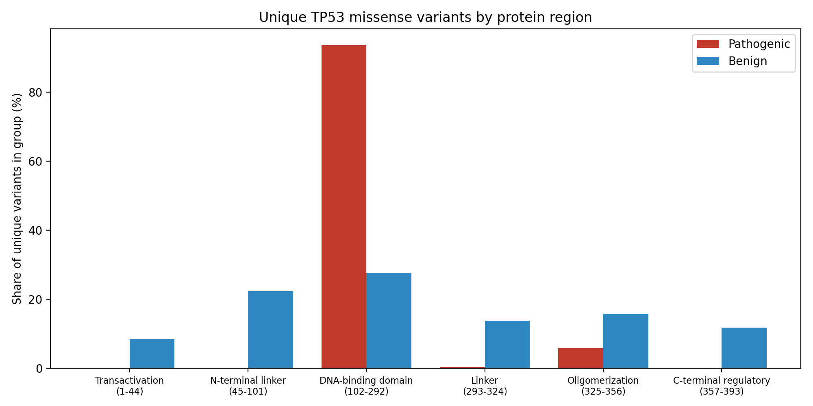
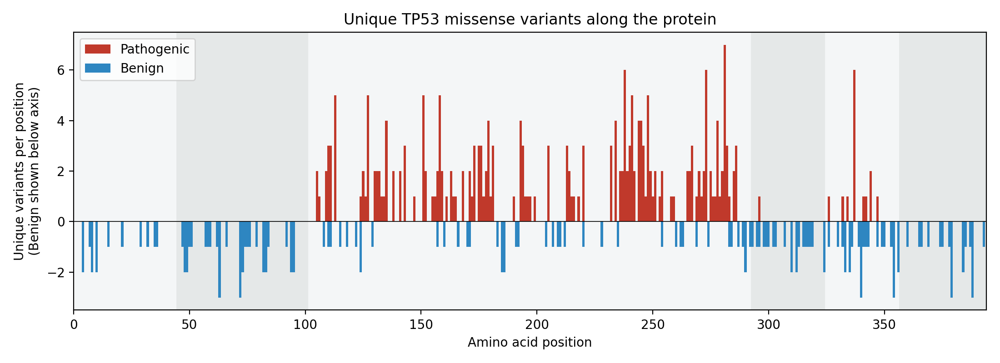

# TP53 Missense Variant Landscape

**A Bioinformatics Analysis of Clinical Variant Classification Across TP53 Protein Domains**

## Overview

The *TP53* gene encodes the tumor protein p53, a transcription factor that plays a central role in cellular stress responses, cell-cycle regulation, DNA damage responses, and tumor suppression. Alterations in TP53 are frequently associated with human cancers, making the characterization of TP53 variants important in cancer biology and molecular genetics.

This project explores the distribution of TP53 missense variants across functional protein regions and investigates the relationship between protein-domain location and clinical classification.

Using ClinVar-derived variant records, the analysis applies data cleaning, protein-position mapping, classification filtering, visualization, and statistical testing to investigate differences between pathogenic and benign variants.

## Research Questions

This project addresses four main questions:

1. How are TP53 missense variants distributed across the protein?
2. Which protein regions contain the largest numbers of pathogenic and benign variants?
3. Is the DNA-binding domain associated with a higher proportion of pathogenic classifications than the remainder of the protein?
4. How can variant-level data analysis help characterize the relationship between protein structure and clinical interpretation?

## Objectives

- Clean and standardize TP53 missense variant records.
- Extract amino-acid substitutions and protein positions from variant annotations.
- Map variants to predefined TP53 protein regions.
- Compare pathogenic and benign classifications across protein domains.
- Visualize variant distributions along the protein sequence.
- Evaluate the association between DNA-binding domain location and pathogenic classification using Fisher's exact test.

## Data Source

The analysis uses TP53 variant records derived from **ClinVar**, a public database of reported relationships between genetic variants and clinical significance.

The input file used in this project is:

`data/raw/clinvar_tp53_missense.txt`

The original records are processed to extract protein-level information and clinical classifications.

**Data availability:** The input file must be supplied locally at the path above. It is not currently included in the repository. For reproducibility, users should document the original download URL, retrieval date, and any database release information when obtaining the source data.

ClinVar classifications reflect submitted clinical interpretations and may change as evidence and expert review evolve.

## Methods

### 1. Data Cleaning and Quality Control

The preprocessing workflow:

- Reads the raw TP53 variant records.
- Filters records associated with the selected protein transcript.
- Extracts protein changes and amino-acid positions.
- Identifies records without a successfully parsed protein change.
- Checks for invalid protein positions.
- Identifies candidate missense records.
- Groups clinical classifications into pathogenic, benign, uncertain, conflicting, and other categories.

The initial preprocessing run identified **1,490 candidate missense records** for downstream processing.

### 2. Protein-Domain Mapping

Protein positions are assigned to predefined regions of TP53:

| Protein region | Amino-acid positions |
|---|---:|
| Transactivation | 1–44 |
| N-terminal linker | 45–101 |
| DNA-binding domain | 102–292 |
| Linker | 293–324 |
| Oligomerization | 325–356 |
| C-terminal regulatory region | 357–393 |

These boundaries provide a simplified framework for comparing variant distributions across regions. They are not intended to represent every structural or functional subregion of TP53.

### 3. Classification Filtering and Deduplication

The domain-level comparison focuses on records classified as either **Pathogenic** or **Benign**. Records with uncertain, conflicting, or other classifications are not included in this binary comparison.

Repeated protein-change records are also identified to reduce duplicate representation in the domain-level analysis.

After filtering and deduplication, the analysis included **417 records**:

- Pathogenic: 256
- Benign: 161

These numbers describe the records included in the reported comparison and should not be interpreted as a complete census of all TP53 variants.

### 4. Statistical Analysis

Fisher's exact test is used to evaluate the association between DNA-binding domain location and pathogenic versus benign classification.

The comparison uses a two-by-two contingency table:

| Location | Pathogenic | Benign |
|---|---:|---:|
| DNA-binding domain | 241 | 42 |
| Outside DNA-binding domain | 15 | 119 |

The analysis reports the odds ratio and p-value to quantify the strength of the observed association.

## Results

### Variant Distribution Across Protein Regions

The domain-level comparison shows that pathogenic and benign classifications are distributed differently across the predefined TP53 protein regions.

The DNA-binding domain contains the largest number of pathogenic records in the analyzed dataset.



*Figure 1. Distribution of pathogenic and benign TP53 missense variant records across predefined protein regions.*

### Variant Distribution Along the Protein Sequence

Mapping variant positions along the amino-acid sequence provides a complementary view of where the analyzed variants occur.



*Figure 2. Distribution of TP53 missense variants along the protein sequence.*

### DNA-Binding Domain Association

The statistical analysis produced the following results:

| Measure | Result |
|---|---:|
| Pathogenic records in the DNA-binding domain | 241 |
| Benign records in the DNA-binding domain | 42 |
| Pathogenic records outside the domain | 15 |
| Benign records outside the domain | 119 |
| Odds ratio | 45.52 |
| Fisher's exact test p-value | 3.10 × 10⁻⁵⁰ |

The observed odds ratio indicates a strong association between location within the DNA-binding domain and pathogenic classification in this dataset.

The very small p-value provides strong statistical evidence against independence between domain location and classification under the assumptions of the test.

These findings describe an association within the analyzed records; they do not establish causation or determine the clinical significance of an individual variant.

## Biological Interpretation

The DNA-binding domain is essential to p53's role as a transcription factor. Changes affecting this region may interfere with DNA recognition and the regulation of downstream target genes.

The enrichment of pathogenic classifications in this region is consistent with the biological importance of DNA binding for p53 function.

However, domain location alone cannot explain every variant's effect. Functional consequences depend on the specific amino-acid substitution, molecular context, experimental evidence, and available clinical data.

## Repository Structure

```text
Tp53-variant-landscape/
├── figures/
│   ├── variants_by_region.png
│   └── variants_along_protein.png
├── scripts/
│   ├── clean_data.py
│   └── map_domains.py
├── domain_counts.csv
├── requirements.txt
└── README.md
```

The raw and processed data files are generated or supplied locally and are not currently listed among the repository's tracked files.

## Requirements

- Python 3
- The Python packages listed in `requirements.txt`

## How to Run

### 1. Clone the repository

```bash
git clone https://github.com/Parmida-Mehranfarid/Tp53-variant-landscape.git
cd Tp53-variant-landscape
```

### 2. Install dependencies

```bash
python -m pip install -r requirements.txt
```

### 3. Add the input data

Place the source file at:

```text
data/raw/clinvar_tp53_missense.txt
```

Ensure that the file format matches the format expected by the preprocessing script.

### 4. Run preprocessing

```bash
python scripts/clean_data.py
```

This step generates the processed dataset required by the downstream analysis.

### 5. Run domain mapping and statistical analysis

```bash
python scripts/map_domains.py
```

This step performs protein-region mapping, classification comparison, statistical testing, and figure generation.

**Note:** The input file and the processed dataset must be available locally before running the full workflow. The generated outputs depend on the supplied data and the versions of the scripts.

## Limitations

- The analysis depends on the ClinVar records and classifications available in the selected input dataset.
- Clinical classifications may change as new evidence becomes available.
- Variants with uncertain or conflicting interpretations are excluded from the pathogenic-versus-benign comparison.
- Repeated protein-change records and transcript-selection rules can affect the analyzed variant set.
- The domain boundaries are predefined and simplify the biological complexity of the protein.
- Fisher's exact test evaluates association, not causation.
- The analysis does not account for all potential sources of bias, including differences in variant reporting, evidence availability, and submission practices.
- No conclusions about the clinical significance of an individual variant should be drawn from this analysis alone.

## Future Directions

Potential extensions of this project include:

- Adding reproducible ClinVar data retrieval and version tracking.
- Comparing results across transcript definitions.
- Incorporating additional evidence such as ClinVar review status and functional assay data.
- Examining individual amino-acid substitutions and recurrent variants.
- Integrating structural information to explore potential effects on p53 function.
- Adding automated data-quality checks and a reproducible analysis report.
- Expanding the analysis to other cancer-associated genes for comparative investigation.

## Skills Demonstrated

- Python-based data processing
- Variant annotation and protein-position parsing
- Data cleaning and quality control
- Protein-domain mapping
- Clinical variant classification analysis
- Data visualization
- Statistical hypothesis testing
- Biological interpretation of genomic data
- Reproducible research practices

## Author

**Parmida Mehranfarid**

This project was developed as an independent bioinformatics analysis exploring the relationship between TP53 protein regions and clinical variant classifications, with an emphasis on cancer biology, molecular genetics, and computational analysis.

## Disclaimer

This repository is intended for educational and research purposes. It is not a clinical decision-support tool and should not be used to diagnose disease or guide patient management.
